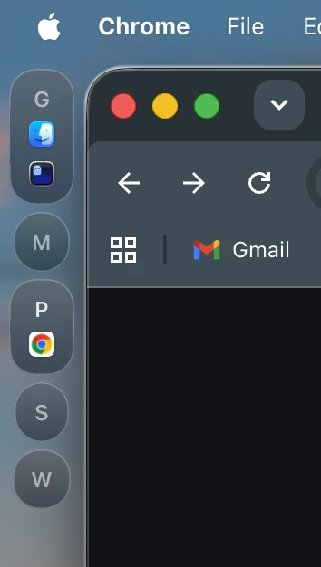

# NanoBar


A lightweight AeroSpace workspace bar for macOS — pure Swift/SwiftUI, no Electron, no shell scripts on the hot path.

Unlike script-driven bars, NanoBar talks to AeroSpace over a Unix socket and renders natively: no polling loops, no config language to learn, and it works out of the box with zero configuration.

**Requires macOS 15 (Sequoia) or later**



*Sidebar mode (`bar-position = left`)*

---

## Features

- **AeroSpace integration** — workspace indicator with app icons and socket-based live updates
- **Liquid Glass pills** — native macOS 26 glass effect with hover/focus states; vibrancy blur fallback on macOS 15
- **Multi-monitor** — one bar per screen, automatically managed
- **Fullscreen aware** — bar hides when a fullscreen window covers the screen
- **Native performance** — ~0% CPU at idle

---

## Quick start

**1. Install and start** (Homebrew):

```bash
brew install xeydev/tap/nanobar
brew services start nanobar
```

**2. Hook up AeroSpace** — add this to `~/.aerospace.toml` so workspace changes appear instantly:

```toml
exec-on-workspace-change = ['/bin/bash', '-c',
  'printf "%s" "$AEROSPACE_FOCUSED_WORKSPACE" | nc -U /tmp/nanobar-notify.sock']
```

**3. Reload AeroSpace config:**

```bash
aerospace reload-config
```

Done — the bar is running with default settings. To customize, see [Configuration](#configuration).

### Building from source

```bash
git clone https://github.com/xeydev/nanobar
cd nanobar
bash build-release.sh
```

Produces a `dist/` directory with `bin/nanobar` and `libexec/NanoBar`. Add `dist/bin` to your `PATH` or copy the contents to your preferred prefix.

For development, `./build-dev.sh` builds a debug binary and (re)starts NanoBar; log at `/tmp/nanobar-debug.log`.

Logs (service): `/tmp/nanobar.log` and `/tmp/nanobar.err`.

---

## Configuration

Zero-config first: NanoBar runs on sensible defaults with no configuration at all. To customize, edit `~/.config/nanobar/config` — a plain `key = value` file (a fully-commented reference is written on first launch). The file is watched: edits apply live, no restart needed.

```
theme = dark
bar-position = left
workspaces-mode = labelsOnly
```

Lines starting with `#` are comments; trailing ` # …` comments are stripped (leading-`#` hex colors are kept).

### Workspaces widget

```
workspaces-mode = expandOnHoverAndActive
```

When a workspace pill expands to show its app icons:

- `expanded` — every workspace always shows its icons
- `collapsed` — labels only, never any icons
- `expandOnHover` — icons appear while the pill is hovered
- `expandOnActive` — the focused workspace shows its icons
- `expandOnHoverAndActive` — icons on hover or on the focused workspace (default)

### App

```
theme = system   # system | light | dark
```

### Bar

```
bar-position = top          # top | left | right
bar-background = none       # none | blur | color:#RRGGBBAA
bar-blur-material = regular # regular | thin | ultraThin (blur background)
bar-min-height = 30
bar-corner-radius = 0
bar-shadow = false
bar-margin = 0            # gap between screen edge and bar
bar-padding = 8           # gap between bar edge and pills
bar-border = false
bar-border-width = 1.0
bar-border-color = #FFFFFF59
```

`bar-margin` and `bar-padding` set all sides; add `-top`/`-right`/`-bottom`/`-left` suffixes for per-side overrides:

```
bar-padding = 8
bar-padding-left = 16
```

### Pill

```
pill-style = blur              # liquidGlass | blur | solid | none
pill-height = 30
pill-min-width = 30
pill-corner-radius = 15
pill-border = true
pill-border-width = 0.75
pill-border-color = #FFFFFF47  # unset = adaptive

# Glass effect per interaction state (liquidGlass style):
pill-glass-default = clear     # regular | clear | identity
pill-glass-hover = regular
pill-glass-toggled = regular

# Blur appearance — blur style, and pre-macOS 26 fallback for liquidGlass:
pill-blur-material = regular   # regular | thin | ultraThin
pill-blur-specular = true      # white gradient overlay
pill-blur-shadow = false

# Solid style — color is an #RRGGBBAA hex string:
pill-solid-color = #1C1C1ECC
pill-solid-shadow = false
```

---

## Uninstalling

Homebrew install:

```bash
brew services stop nanobar
brew uninstall nanobar
```

Manual install from source:

```bash
launchctl unload ~/Library/LaunchAgents/com.user.nanobar.plist
rm ~/Library/LaunchAgents/com.user.nanobar.plist
rm "$(command -v nanobar)"   # wherever you copied it (/opt/homebrew/bin, /usr/local/bin, …)
```

Either way, config removal is optional:

```bash
rm -rf ~/.config/nanobar
```
